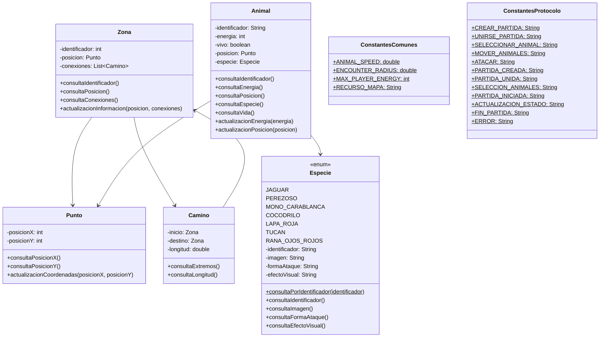

# JungleAttackCommon

Librería compartida (paquetes common.model y common.constantes) que usan el cliente y el servidor. Incluye mapa.json en src/main/resources.

Instalación local: mvn install.

El cliente y el servidor declaran esta librería como dependencia (jungleattack-common). Por eso debe instalarse primero, tanto de forma local como en la automatización de GitHub Actions de los otros dos repositorios.

## common.model

Este paquete contiene las clases del modelo que comparten el cliente y el servidor. Evita mantener dos implementaciones independientes de los mismos objetos. Cada aplicación hereda de estas clases cuando necesita atributos o comportamientos adicionales.

### Punto

- Atributos: posicionX: int, posicionY: int
- Métodos: consultaPosicionX(), consultaPosicionY(), actualizacionCoordenadas(posicionX, posicionY)

Representa unas coordenadas del mapa. Tiene un constructor vacío (para las librerías que crean objetos sin datos) y otro con las dos coordenadas.

### Zona

- Atributos: identificador: int, posicion: Punto, conexiones: List<Camino>
- Métodos: consultaIdentificador(), consultaPosicion(), consultaConexiones(), actualizacionInformacion(posicion, conexiones)

Representa un lugar del mapa (por ejemplo, Monteverde o Tortuguero). Su identificador va del 1 al 12. El mapa funciona como un grafo: las conexiones se agregan después de crear las zonas, porque un camino necesita que sus dos zonas ya existan. La lista de conexiones nunca es null.

### Camino

- Atributos: inicio: Zona, destino: Zona, longitud: double
- Métodos: consultaExtremos(), consultaLongitud()

Representa una conexión transitable entre dos zonas. consultaExtremos() devuelve un arreglo con las dos zonas.

### Animal

- Atributos: identificador: String, energia: int (volátil), vivo: boolean (volátil), posicion: Punto, especie: Especie
- Métodos:
    - consultaIdentificador()
    - consultaEnergia()
    - consultaPosicion()
    - consultaEspecie()
    - consultaVida()
    - actualizacionEnergia(energia)
    - actualizacionPosicion(posicion)

Contiene los atributos comunes de un animal. La energía nunca es negativa: al llegar a 0 el animal muere y un animal muerto no recupera energía ni vuelve a la vida. Las reglas (cuánto daño recibe, el máximo de energía, etc.) las decide el servidor. Los atributos de energía y vida son volátiles porque los lee un hilo mientras otro los modifica.

### Especie — enum

- Valores: JAGUAR, PEREZOSO, MONO_CARABLANCA, COCODRILO, LAPA_ROJA, TUCAN, RANA_OJOS_ROJOS
- Atributos: identificador: String, imagen: String, formaAtaque: String, efectoVisual: String
- Métodos: consultaPorIdentificador(identificador) (estático), consultaIdentificador(), consultaImagen(), consultaFormaAtaque(), consultaEfectoVisual()

Contiene los 7 animales nativos de Costa Rica que pueden usarse en el juego, con la ruta de su imagen SVG, su forma de ataque (ZARPAZO, MORDISCO, PICOTAZO o LENGUETAZO) y la ruta del SVG de su efecto visual. El servidor conserva la lógica de las reglas, mientras que el cliente utiliza los recursos visuales.

## common.constantes

### ConstantesComunes

- Atributos estáticos:
    - ANIMAL_SPEED: double
    - ENCOUNTER_RADIUS: double
    - MAX_PLAYER_ENERGY: int
    - RECURSO_MAPA: String
    - Nombres de los campos de mapa.json (MAPA_ANCHO, MAPA_ALTO, MAPA_ZONAS, MAPA_CAMINOS, ZONA_ID, ZONA_NOMBRE, ZONA_X, ZONA_Y, ZONA_POLIGONO, CAMINO_ID, CAMINO_DESDE, CAMINO_HASTA, CAMINO_LONGITUD)

Contiene las constantes que deben tener el mismo valor en el cliente y en el servidor. La velocidad de los animales y el radio de encuentro los usa el servidor para calcular el movimiento y los combates. La energía máxima limita la recuperación de energía de los animales de un jugador. Los nombres de los campos del mapa los usan ambas aplicaciones para leer mapa.json. El constructor es privado.

### ConstantesProtocolo

- Atributos estáticos:
    - Tipos de mensaje del cliente al servidor: CREAR_PARTIDA, UNIRSE_PARTIDA, SELECCIONAR_ANIMAL, MOVER_ANIMALES, ATACAR, VER_ZONA
    - Tipos de mensaje del servidor al cliente: PARTIDA_CREADA, PARTIDA_UNIDA, ERROR, SELECCION_ANIMALES, PARTIDA_INICIADA, ACTUALIZACION_ESTADO, FIN_PARTIDA
    - Tipos internos: DESCONEXION, TIPO_INVALIDO
    - Nombres de los campos del contenido de los mensajes (CAMPO_APODO, CAMPO_CODIGO, CAMPO_ESPECIE, CAMPO_IDS_ANIMALES, CAMPO_OBJETIVO, CAMPO_X, CAMPO_Y, etc.)
    - Valores del protocolo: RESULTADO_VICTORIA, RESULTADO_DERROTA, RAZON_BANDERA, RAZON_ABANDONO, EVENTO_ATAQUE, EVENTO_MUERTE, SEPARADOR_LISTA
    - Motivos de error: MOTIVO_APODO_INVALIDO, MOTIVO_PARTIDA_NO_ENCONTRADA, MOTIVO_PARTIDA_LLENA, MOTIVO_ESPECIE_NO_DISPONIBLE, MOTIVO_OPONENTE_DESCONECTADO, MOTIVO_FUERA_DE_ALCANCE, MOTIVO_SIN_CONEXION, entre otros

Contiene los tipos de mensaje (con los nombres del enunciado, como CREATE_MATCH o STATE_UPDATE), los nombres de los campos del JSON y los motivos de error del protocolo. Así el cliente y el servidor no repiten textos fijos en el código. El constructor es privado.

VER_ZONA (VIEW_ZONE) se conserva en el protocolo, pero ninguna de las dos aplicaciones lo usa: el servidor envía en cada STATE_UPDATE todas las zonas que el jugador puede ver y el cliente cambia la zona que está mirando sin enviar mensajes.

## Recursos

### mapa.json

Define el mapa que leen las dos aplicaciones: un mapa de 950 x 550 con 12 zonas y 15 caminos.

- Cada zona tiene id, nombre, x, y (su centro), caja, poligono (los puntos que la delimitan) y etiqueta (dónde se escribe su nombre).
- Cada camino tiene id, desde, hasta (identificadores de las zonas que une) y longitud.

El servidor lo usa para construir el mapa y calcular rutas. El cliente lo usa para dibujar las zonas, los caminos y la niebla.

## Herencia, interfaces y polimorfismo

- common.model.Animal es la clase base de Animal del servidor y de AnimalVisible del cliente.
- common.model.Zona es la clase base de Zona del servidor y de ZonaVisible del cliente.
- common.model.Camino es la clase base de Camino del servidor y de CaminoVisible del cliente.
- common.model.Punto es la clase base de Punto del servidor y de PuntoVisible del cliente.
- Especie es un enum: tiene un conjunto fijo de valores con sus datos descriptivos.

## Elementos estáticos

- ConstantesComunes contiene las constantes compartidas por el cliente y el servidor.
- ConstantesProtocolo contiene los textos fijos del protocolo de mensajes.
- Especie.consultaPorIdentificador() busca una especie por su identificador.

## Patrones de diseño

Esta librería no define patrones de diseño: solo ofrece las clases base y las constantes que usan el cliente y el servidor.

## Pruebas unitarias

Las pruebas están en src/test/java, con la misma estructura de paquetes, y se ejecutan con mvn test (JUnit 5).

- common.model: PuntoTest, ZonaTest, CaminoTest, AnimalTest, EspecieTest
- common.constantes: ConstantesComunesTest, ConstantesProtocoloTest

El flujo .github/workflows/tests.yml compila y ejecuta las pruebas en cada push y pull request (Java 21).

## Diagrama de clases

